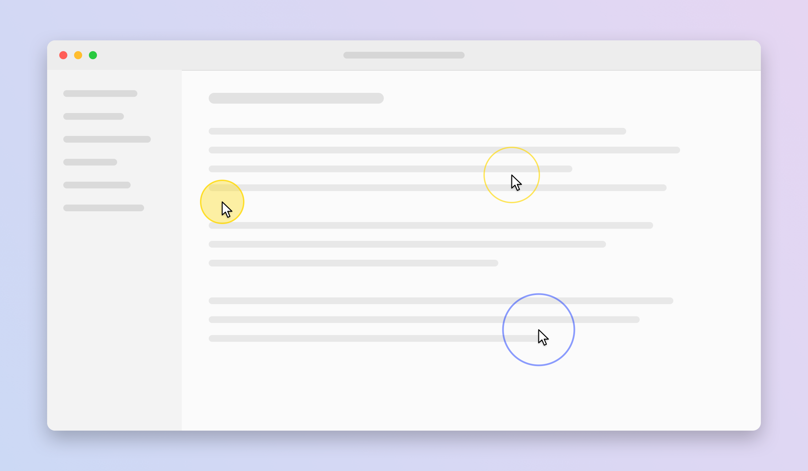
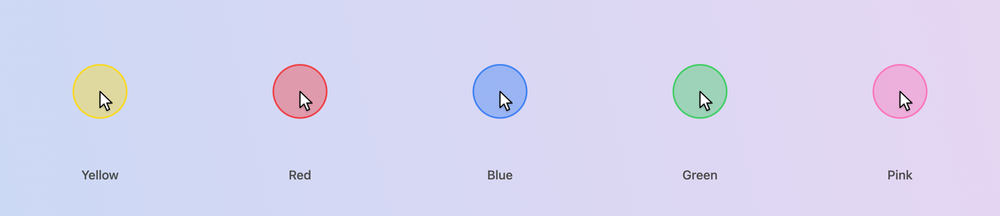

# Cursor Halo

A tiny menu bar app for macOS that makes your mouse pointer easy to see. Handy for screen sharing, recordings, presentations, or just finding the cursor on a big display.



The five colors:



## Features

- **Highlight circle:** a soft colored circle that follows the pointer on every screen
- **Click ripple:** a ring expands from each click, with different colors for left and right clicks
- **Keyboard shortcut** to show or hide the highlight circle. The default is **Control+Option+Command+H**. You can record any other shortcut, including a key combo sent by a programmable mouse button
- **Size:** small, medium or large
- **Color:** yellow, red, blue, green or pink
- **Launch at login**
- Never gets in the way: the overlay ignores all clicks
- **No special permissions** needed: no Accessibility or Input Monitoring prompts

macOS already has a pointer size and color setting, and shake to locate, under **System Settings > Accessibility > Display > Pointer**. Cursor Halo adds the always-on highlight and click effects that macOS doesn't have.

## Requirements

- macOS 14 or later (developed on macOS 26, Apple Silicon)
- Apple's Command Line Tools (full Xcode is not needed)

## Getting started

1. **Install the Command Line Tools.** Open the Terminal app and run `xcode-select --install`. Click Install in the window that appears and wait for it to finish. Skip this if you already have Xcode or the tools.
2. **Download and install Cursor Halo.** In Terminal, run:

   ```sh
   git clone https://github.com/masharratt/mac-cursor-halo.git
   cd mac-cursor-halo
   scripts/bundle.sh --install
   ```

   This builds the app, copies it to `/Applications/CursorHalo.app` and opens it. Without `--install`, the app is left in `build/CursorHalo.app`.
3. **Find it in the menu bar.** Look for the dashed-circle icon at the top right of your screen.
4. **Use it.** Press **Control+Option+Command+H** to show or hide the highlight circle. Click the menu bar icon to turn the highlight or click ripples on or off, and to pick a size and color.
5. **Optional: start it at login.** Choose **Launch at Login** in the menu so it is always running.
6. **Updating and uninstalling.**
   - To update, run `git pull` inside the `mac-cursor-halo` folder, then run `scripts/bundle.sh --install` again.
   - To uninstall, choose **Quit** from the menu bar icon, then delete `/Applications/CursorHalo.app`.

## Change the shortcut

1. Click the menu bar icon and choose **Change Shortcut...**
2. Press the new key combination, or press your mouse button
3. The shortcut needs Command, Control or Option, or must be a function key (F1 to F20), so it can't steal plain typing

Cursor Halo takes the shortcut over system wide, so the same combination stops working in other apps. **Reset Shortcut** brings back Control+Option+Command+H.

## Run the tests

```sh
swift test
```

## Development

The README images are generated from the app's real drawing settings with synthetic content: `swift run CursorHalo --render-demo docs/images` (hidden flag; writes the PNGs and exits).
