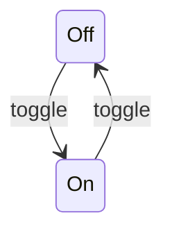
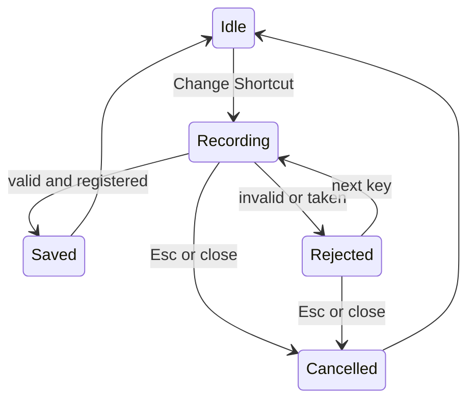

# State Machines

**Last Updated:** 2026-10-15 (added shortcut recorder lifecycle)

## 1. Effects

**Source:** Sources/CursorHaloCore/EffectsState.swift:17

### States

| State | Meaning |
|-------|---------|
| Off | Master switch off. Nothing is drawn, per-effect flags are kept. |
| On | Master switch on. Highlight and ripple follow their own flags. |

### Transitions

| From | To | Trigger | Guard |
|------|----|---------|-------|
| Off | On | Menu "Effects On" or hotkey | None |
| On | Off | Menu "Effects On" or hotkey | None |

### Diagram

## 2. Shortcut Recorder

**Source:** Sources/CursorHalo/ShortcutRecorderWindow.swift, Sources/CursorHaloCore/HotKey.swift (ShortcutRecorder)

### States

| State | Meaning |
|-------|---------|
| Idle | No recorder window. The saved shortcut is registered. |
| Recording | Window open, current shortcut unregistered, waiting for a key press. |
| Rejected | Last press was invalid or already owned by another app. Message shown, still recording. |
| Saved | New shortcut registered and stored. Window closes, returns to Idle. |
| Cancelled | Esc or window closed. Old shortcut re-registered, returns to Idle. |

### Transitions

| From | To | Trigger | Guard |
|------|----|---------|-------|
| Idle | Recording | Menu "Change Shortcut…" | None |
| Recording | Saved | Key press | Passes validation and RegisterEventHotKey succeeds |
| Recording | Rejected | Key press | Fails validation or RegisterEventHotKey fails |
| Rejected | Recording | Next key press | None |
| Recording | Cancelled | Esc or close button | None |
| Rejected | Cancelled | Esc or close button | None |

### Diagram

