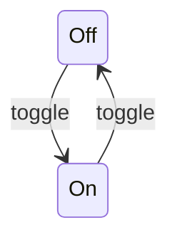

# State Machines

**Last Updated:** 2026-10-15 (initial v1 effects state)

## 1. Effects

**Source:** Sources/CursorHaloCore/EffectsState.swift:17

### States

| State | Meaning |
|-------|---------|
| Off | Master switch off. Nothing is drawn, per-effect flags are kept. |
| On | Master switch on. Highlight and ripple follow their own flags. |

### Transitions

| From | To | Trigger | Guard |
|------|----|---------|-------|
| Off | On | Menu "Effects On" or hotkey | None |
| On | Off | Menu "Effects On" or hotkey | None |

### Diagram

